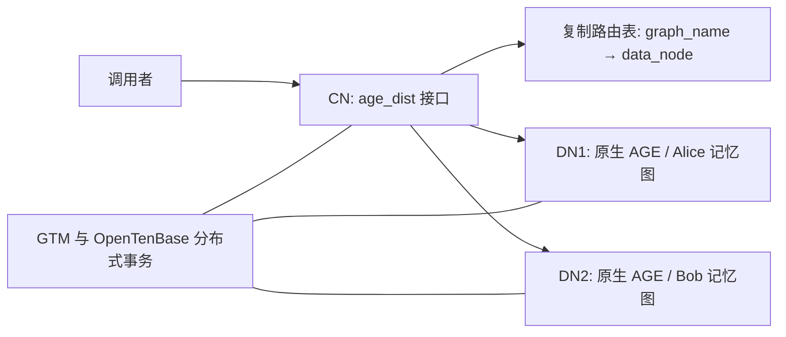

# 设计与实测报告

作者：付格丞 / gechengfu。日期：2026-11-26。方向：C，图记忆（AGE）。

## 1. 目标与选型

课后题要求适配 AGE，使其满足 OpenTenBase 分布式架构。本作业选择可落地的一种分布方式：**用户记忆图作为分片单元**。同一用户的顶点、边和 AGE 图目录一起保存在一个 DN，不同用户的图可以分布到不同 DN；CN 提供统一调用入口。

这样保留了 Apache AGE 原生 Cypher 的语义和执行器，图内多跳访问不需要跨节点交换边集合。代价是单张大图不能水平拆分，本次没有实现任意图的跨 DN 遍历。这是范围受限的真实插件移植与分布式适配，并非完整图分布式引擎。

## 2. 实际架构

`age_dist.graph_routes` 使用 `DISTRIBUTE BY REPLICATION`。新图按图名 MD5 前 32 位对排序后的 DN 列表取模，也允许显式指定 DN。分配结果写入路由表，后续查询只使用持久路由，因此新增节点不会导致旧图“换位置”。创建时先取得图名对应的 CN 事务 advisory lock，再插入唯一路由记录、调用 DN 建图；这些步骤处于同一个事务。

Apache AGE 的 `ag_graph`、`ag_label` 与标签表是所属 DN 上的本地对象。不要把这些本地图目录与跨节点复制的**路由表**混淆。实测直接检查两个 DN 的本地目录，确认图只出现在分配给它的节点上。

## 3. 关键适配

### 3.1 PG11 接口与 OpenTenBase ABI

原始 Apache AGE PG11 源码不能直接在本实验 OpenTenBase 上编译。实际遇到的问题包括：拆分的 `pg_*_d.h` 不存在；tuple slot API 已变化；`ProcessUtility` / planner / parse hooks 参数不同；建 schema、结果关系初始化、类型强制转换等接口签名不同；扫描器辅助函数重名。

补丁在 `opentenbase_compat.h` 集中适配调用，修改钩子函数签名并传递新增参数。slot 物化后取得有效 heap tuple，区分带 buffer 与不带 buffer 的 tuple 存储。强制包含的兼容头没有自动依赖跟踪，因此构建脚本始终先 clean。最终全量构建未产生编译 warning/error，日志保存在 `evidence/build.txt`。

### 3.2 图内 ID 序列

原版 AGE 创建标签和实体时使用 PostgreSQL 序列。直接在 DN 新建序列再走 OpenTenBase 全局 `nextval`，会访问未在 GTM 注册的序列，本次实验实际复现了这一错误。

整图已经固定在一个 DN，因此补丁把 AGE 序列设为 OpenTenBase 本地序列，并使用 `nextval_local`。SQL 默认值经 `_age_local_nextval` 分配实体 ID，检查 48 位 entry ID 范围；label ID 继续使用 AGE 的原生范围检查。ID 只保证图内含义，跨图引用必须同时携带图名。并发测试执行 3 轮，每轮 4 个并发会话提交 12 次写入，共得到 36 个不同 ID。

### 3.3 写连接与分布式事务

OpenTenBase 的 `EXECUTE DIRECT ... SELECT ...` 默认申请只读数据节点连接。但 AGE 的建图和 Cypher 写入都从 SELECT 调用进入，首次运行因此报“should not execute write on readonly datanode process”。

补丁注册 planner hook，**只识别目标表达式精确为 `_age_otb_worker` 函数 OID 的 EXECUTE DIRECT**，将该远程计划标记为读写并设置访问类型。其他查询保持原有行为；钩子继续调用此前钩子或 OpenTenBase 自己的 planner。没有修改 OpenTenBase 内核源码，也没有关闭集群事务限制。

worker 通过 SPI 调用原生 `ag_catalog.create_graph` / `cypher` / `drop_graph`，不另开数据库连接、不内部提交。实测一个 CN 事务写入两个 DN：COMMIT 后两边可见，ROLLBACK 或后续 Cypher 报错后两边均不可见；建图回滚时路由和 DN 图目录也一起消失。

### 3.4 并发标签创建

真实并发测试发现原生 AGE 在首次隐式创建同一标签时会发生系统目录唯一键冲突。最终方案在**图所属 DN**上获取图名对应的事务级 advisory lock，且在解析 Cypher 前获取。锁是数据库与节点局部的，不同 CN 路由到同一 DN 时会竞争同一把锁；多 CN 行为尚未实际验证。

CN 用 OpenTenBase 的事务级 advisory lock 保护逻辑路由：CREATE/DROP 排他，Cypher 共享；DN 的另一组事务锁串行化图操作。曾尝试依赖复制路由行上的锁或唯一键，但并发验收出现等待超时，因此最终在修改复制表前取得逻辑路由锁，并对并发重复建图连续验证 3 轮。图名 32 位 hash 碰撞只会增加两个图之间的锁竞争，不会合并它们的数据。

### 3.5 参数与结果

远端节点名按 SQL 标识符引用，所有输入值按字面量引用；Cypher 使用不出现在查询字符串中的 dollar-quote delimiter。验收包含中文、单引号、双引号、`$$`、预选 delimiter 和看似 SQL 的文本，数据原样返回且路由 schema 保留。

结果使用 AGE 的输出函数序列化，再包装为 JSONB 行数组，使 CN 无需把某个 DN 的图 OID、标签关系或 `agtype` 二进制对象解释成自己的本地对象。代价是结果需整体物化，应用应使用 LIMIT，并按原生 agtype 文本理解顶点、边、路径标记。

## 4. 环境与证据

| 项目 | 实际值 |
| --- | --- |
| 部署 | 本机 Lima Linux VM 内的两个 Docker 容器；无付费云服务 |
| 拓扑 | 1 GTM、1 CN、2 个主 DN；已有备用实例不属于本次故障测试 |
| 数据库 | OpenTenBase 5.21.8，`version()` 返回 PostgreSQL 10.0 @ OpenTenBase_v5.0 / V5.21 |
| 编译环境 | Ubuntu 20.04.6 LTS，aarch64，GCC 9.4.0 |
| AGE | PG11 固定提交 `1bb3aff56470499a1c036ae36eee4dfeeb9566b4`，扩展 1.5.0 |
| Python 测试依赖 | 标准库 + 真实 psql，不使用 mock |
| 测试 | 20 项通过，包含两个并发用例 |

保留的 OpenTenBase 源目录没有 `.git` 元数据，因此没有宣称已验证内核 commit SHA；兼容目标以实际 `version()`、安装目录版本及服务器开发头文件为准。

证据文件：

- [build.txt](evidence/build.txt)：全量编译输出。
- [tests.txt](evidence/tests.txt)：实际 unittest 输出。
- [sql-records.json](evidence/sql-records.json)：测试发出的 SQL、退出码、stdout、stderr，含预期失败的负向用例。
- [demo.txt](evidence/demo.txt)：两张记忆图分布在不同 DN，原生两跳关系检索和回滚后的零残留路由。
- [reproduction.txt](evidence/reproduction.txt)：固定上游文件验证、补丁应用与构建源码一致性检查。

测试不依赖固定数据库 OID 或固定 graphid；每轮使用随机唯一前缀，清理仅限本轮显式创建的图。负向测试返回非零退出码是预期结果，不能把这些 SQL 错误当成测试套件失败。

## 5. 未完成的能力与后续路径

本次解决的是**多张完整图在 OpenTenBase 上的分布存储与事务访问**。单张图内部按顶点/边分片、跨 DN 变量长度路径执行、跨图查询、图重平衡、自动迁移、节点故障恢复、权限隔离及备份恢复均未完成。没有跑完 Apache AGE 的全套上游回归；未通过测试的接口不作兼容承诺。

后续若要支持任意大图的顶点级分片，需把 AGE 的 heap 级写入改成分布式可路由操作，并改造图目录一致性、执行计划序列化、跨节点边访问和 VLE 算法。不能仅给标签表加 `DISTRIBUTE BY` 就宣称原生 AGE 已完整支持分布式。

课程提交采用本仓库 `lab/contributions/age-graph-sharding/` 目录，提供可复验补丁、SQL 接口、自动测试和上述边界说明；最终是否满足教师对 C 方向的全部评分要求，由课程评阅决定。
